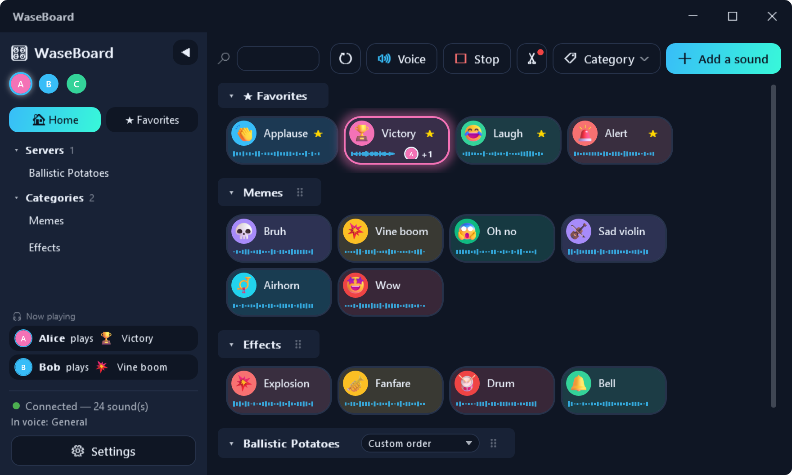

# 🎛️ WaseBoard

*[🇫🇷 Version française](README.md)*

A shared soundboard for Discord: click a sound and it plays both on your speakers and in your
voice channel, for everyone — without ever going through your microphone (so it is not filtered by
noise suppression such as Krisp).

**[⬇ Download the Windows client](https://github.com/salsi64/WaseBoard/releases/latest)** ·
**[💬 Join the WaseBoard Discord](https://discord.gg/HAGTNGFyQd)**

## How it works

By default, the client connects to a **free public instance** (nothing to host, and nobody to ask for
a link): download the app, sign in with Discord, add the bot to your server, and you're ready.
WaseBoard can also be **self-hosted** if you prefer your own private instance (free, ~15 minutes) —
see “Hosting” below.

## Installation / usage

1. [Download and install the client](https://github.com/salsi64/WaseBoard/releases/latest) —
   it connects to the default public instance by itself.
2. Sign in with your Discord account when the app asks — it is only used to show your avatar and to
   find your voice channel, there is nothing else to type in.
3. If the bot is not on your Discord server yet:
   **[➕ Add WaseBoard to my server](https://discord.com/oauth2/authorize?client_id=1546838877631811656&permissions=3146752&scope=bot%20applications.commands)**
   (the “Manage Server” permission is required).
4. Join a voice channel and click 🔊 **Join my voice channel** in WaseBoard.
5. Click a sound — that's it.

Do you have (or want to use) another, self-hosted WaseBoard server? On first launch, click
“Do you have your own WaseBoard server?”, or change the address/token in Settings at any time.

Full guide and FAQ (in French): [`docs/FAQ-utilisateurs.md`](docs/FAQ-utilisateurs.md).

## Features

- **Local preview** (the speaker icon on the left of each button) before really playing in the voice channel; the button lights
  up for everyone while it plays, with the avatar of whoever plays it.
- **Several sounds at the same time**, without cancelling each other between users.
- **🎮 In-game mic** *(experimental)*: your sounds also go through your microphone, for in-game voice chat
  (Valorant, CS2…), with no third-party software and nothing to change in the game. A **🎮 Game / 🎧 Discord**
  button in the toolbar chooses where the sounds go. Guide (in French): [`docs/micro-en-jeu.md`](docs/micro-en-jeu.md).
- **Favorites**, **personal categories** and an **automatic category per Discord server**,
  drag and drop to sort/reorder, real-time search.
- **One emoji per sound**, as glossy 3D emoji (Fluent Emoji), from a built-in or custom palette.
- **“Edit sound” window** (right-click › Edit): name, emoji, button color, categories, per-sound volume, favorite,
  non-destructive **waveform trimming** (the full sound is kept, so you can re-trim any time) and
  **audio file replacement** without losing the rest (name, categories, settings).
- **🌐 Web version (PWA)**: the same sound list from a browser or a phone (“Add to home screen”), Discord sign-in,
  adding and editing sounds (waveform trimming included), nothing to install — at `https://<your server>/app/`, and even **inside Discord** as a voice channel
  Activity (see [`server/README.md`](server/README.md#activité-discord-waseboard-dans-un-salon-vocal), in French). Details: [`server/README.md`](server/README.md#application-web-pwa).
- **🎞 Last-seconds clip**: a shortcut keeps what just played in a game, a video or Discord
  and opens the add window to turn it into a sound (off by default; everything stays in memory, nothing is written to
  disk until you ask). Guide (in French): [`docs/clip-dernieres-secondes.md`](docs/clip-dernieres-secondes.md).
- **Global keyboard shortcuts** (one per sound, and one to switch 🎮 Game / 🎧 Discord, with a short confirmation beep),
  **Sign out** of Discord from Settings, light/dark theme and **Flat** (default), modern or classic interface,
  with independent color palettes. The button waveform is optional: hidden, the buttons
  fit on a single line and the avatar of whoever is playing stays displayed to the right of the name.
- **Automatic identification** (Discord sign-in): your account is enough, WaseBoard finds
  your voice channel by itself — nothing to pick manually.
- **Several Discord servers** on one instance, with catalogs isolated per server; sounds
  from a server you are also a member of stay playable wherever you go.
- **Administration panel** per server (roles, trash with restore, statistics,
  action log, quotas, anti-spam) and an **all-in-one Discord button panel**
  (`/bot-setup`) to get started, join voice or add the bot elsewhere without leaving Discord.
- **Discord commands** `/play` (with search), `/stop`, `/top` and `/bilan`: play a sound or see the server rankings without opening the app;
  operations alerts by direct message to whoever hosts.
- **English and French interface**: WaseBoard follows your Windows language (or the Language setting in Appearance); the
  server's messages follow it too.
- Supported formats: mp3, wav, ogg (Vorbis and Opus), flac, m4a, wma.

## Hosting

Prefer your own instance (separate data, none of the public instance's limits)?
A Docker assistant does everything (Discord bot, automatic HTTPS) — free, ~15 minutes.
Follow [`server/README.md`](server/README.md) (in French), then enter its address in the client (“Do you
have your own WaseBoard server?” on first launch, or Settings afterwards).

## Ideas for improvement

- Import/export of sound selections.
- Multi-server client (connect to several independent WaseBoard instances at once).
- A lighter installer (“framework-dependent” mode, at the cost of requiring the
  [.NET 8 Desktop Runtime](https://dotnet.microsoft.com/download/dotnet/8.0) on every computer).

## Credits

- **Emoji**: [Fluent Emoji](https://github.com/microsoft/fluentui-emoji) (Microsoft, MIT license), displayed
  from the repository via jsDelivr — the few emoji missing from that set (some skin tone variants, 🅾️...)
  fall back to [Twemoji](https://github.com/jdecked/twemoji) (graphics CC-BY 4.0).
